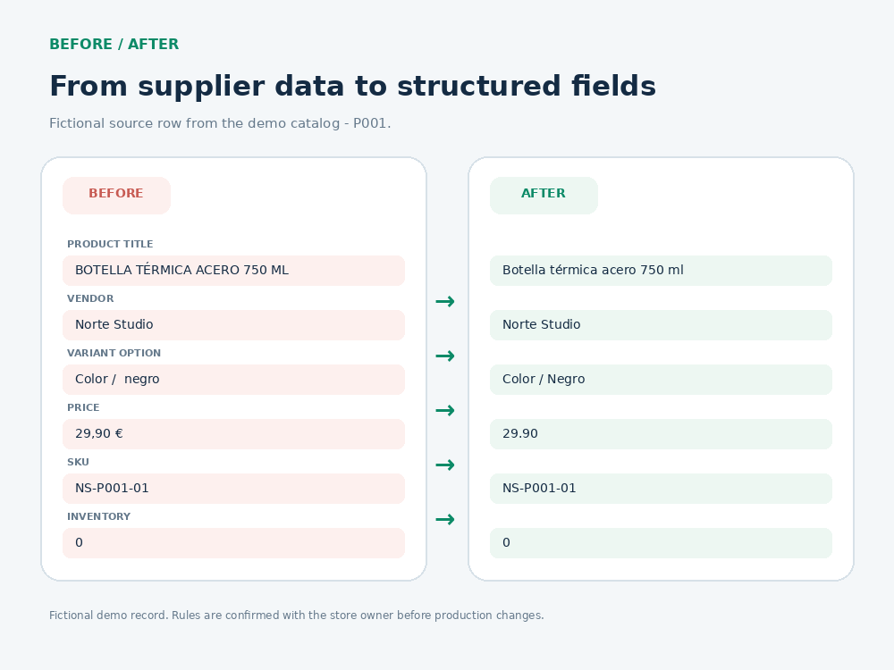
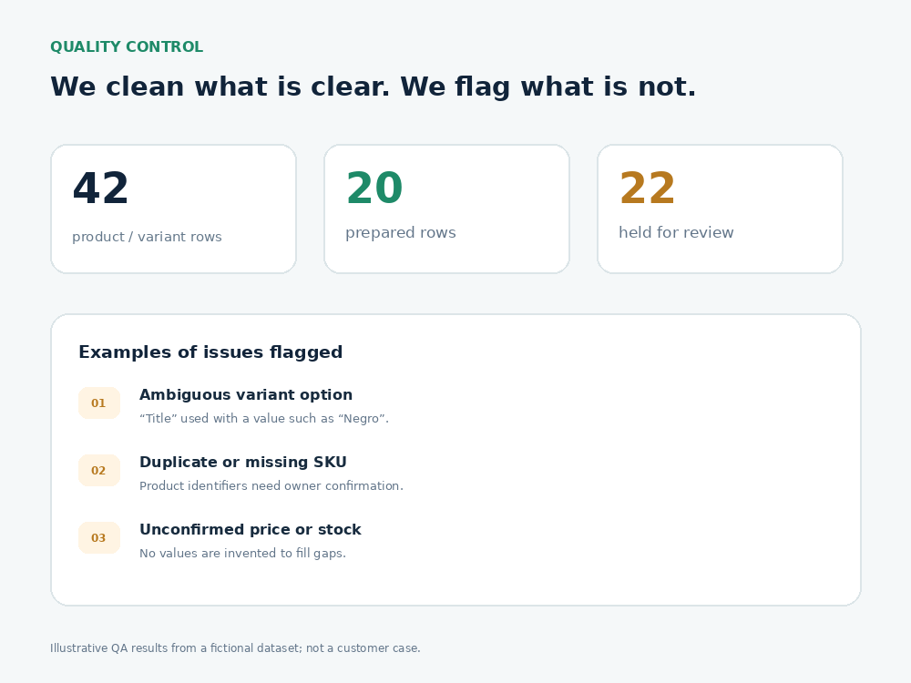
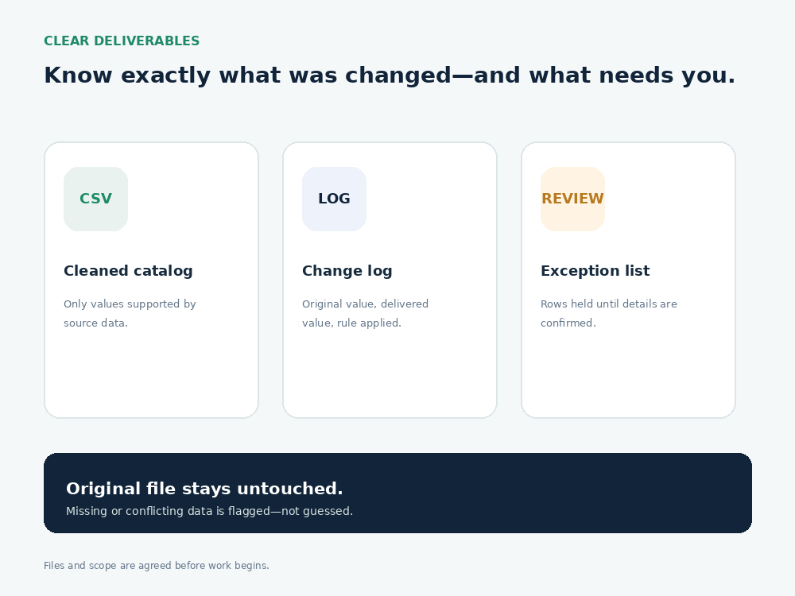

# Shopify Product Catalog Cleanup & QA — Sample Project

**CATALOGO CLARO | Fictional demonstration dataset**

This repository documents a small, end-to-end demonstration of a cautious product-catalog review workflow. It shows how source data can be normalized where the meaning is clear, and how uncertain records can be separated for the store owner's confirmation rather than guessed.

> **Important:** All store, supplier and product information in this repository is synthetic. This is a portfolio exercise, not a client engagement, customer testimonial or live Shopify-store project. The prepared output has **not** been imported into a live Shopify store and is **not represented as guaranteed import-ready**.

## Demo results

| Measure | Result |
|---|---:|
| Fictional source products | 30 |
| Product / variant data rows (excluding header) | 42 |
| Rows prepared for review output | 20 |
| Rows held for owner confirmation | 22 |
| Documented field-level changes | 76 |

The 20 prepared rows represent 10 products. The 22 rows held for confirmation represent 20 products. Issue counts in the QA report are flags, not mutually exclusive row totals; one row may have more than one issue.

## What the workflow demonstrates

1. **Inspect the source:** review the file structure, row count, product/variant relationships and key fields.
2. **Normalize only clear values:** trim whitespace and standardize formatting where the source supports an unambiguous interpretation.
3. **Flag uncertainty:** identify ambiguous variant-option names, duplicate or missing SKUs, missing or non-numeric prices, non-numeric stock and unclear status/publication values.
4. **Separate exceptions:** keep records requiring owner confirmation out of the prepared demonstration output.
5. **Document changes:** maintain a field-level change log and a short QA report.

## Repository contents

- `data/source/fictional_supplier_catalog.csv` — synthetic, intentionally messy supplier-style source data.
- `data/output/prepared_demo_output_not_live_import_tested.csv` — 20 rows prepared where source fields were sufficiently clear. This is a demonstration output only; validate against the store's current Shopify requirements and configuration before any real import.
- `data/output/records_requiring_owner_confirmation.csv` — 22 rows with unresolved or conflicting source information.
- `docs/field_change_log.csv` — 76 documented field-level changes in the demo.
- `docs/sample_qa_report.pdf` — three-page summary of the demo, transformations and exception handling.
- `assets/` — visual examples used to explain the workflow.

## Quality and safety rules

- Never invent missing SKUs, prices, stock quantities, option names or product attributes.
- Preserve product-to-variant relationships where the source data supports them.
- Do not silently resolve duplicate identifiers or ambiguous variant options.
- Keep the original source file unchanged.
- Treat the owner's confirmation as necessary before resolving flagged records.
- Test any production file against the current Shopify import format and the specific store setup; this repository does not claim a successful live import.

## Scope of this sample

This demo covers one fictional CSV source file and a structured review/output workflow. It does not include live store access, direct product publishing, custom metafield mapping, product research, image editing, copywriting or integration work.

## Visual overview

### Before and after

### Quality-control summary

### Deliverables

---

## Need help with your Shopify catalog?

I offer Shopify product catalog cleanup and CSV quality checks through Upwork.

- CSV and Excel catalog cleanup
- SKU and variant validation
- Price and inventory data checks

**[View CATÁLOGO CLARO on Upwork](https://www.upwork.com/services/product/admin-customer-support-a-cleaned-shopify-product-csv-with-a-clear-qa-report-2123468047155513518)**

---

**CATALOGO CLARO** — clean data, clear exceptions.
